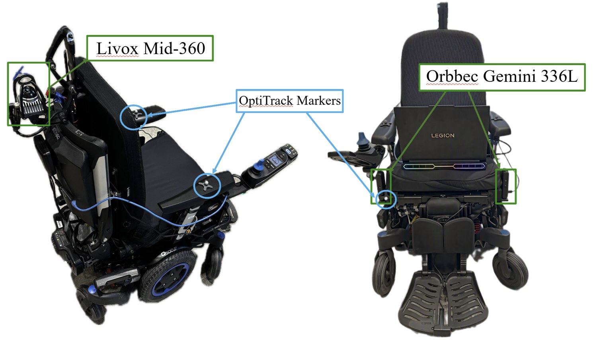

# A Hybrid Multi-Goal Path Planning Framework for Powered Wheelchairs in Dynamic Environments

**From Simulation to Real-World Validation**

Damla Leblebicioğlu\*, Ege Özgül and Taşkın Padır<br>
Electrical and Computer Engineering · Institute for Experiential Robotics, Northeastern University

**[Project page](https://egeozgul.github.io/AutonomousWheelchairProject/)**



---

## Overview

This repository hosts the project page and hardware experiment data for a hybrid planner that lets an
autonomous powered wheelchair visit several goals while avoiding static obstacles and pedestrians.
The framework combines Traveling Salesman Problem (TSP) task ordering, Potential-Field (PF) guidance, and a
local A\* or RRT planner, and models the wheelchair as an ellipse so collision checks reflect its real footprint.

The project page replays each hardware run with synchronized overhead video, the wheelchair's forward
cameras, an animated path plot, and an interactive 3D LiDAR point cloud.

## Hardware

| Component | Role |
| --- | --- |
| Livox Mid-360 LiDAR | Localization outside the motion-capture cage, via LIO-SAM odometry |
| 2 × Orbbec Gemini 336L RGB-D cameras | Forward-facing pedestrian tracking |
| OptiTrack motion capture | Ground-truth pose for the wheelchair and pedestrians inside the cage |

## Experiments

Each folder holds one hardware run.

| Folders | Setting |
| --- | --- |
| `mocap-*` | Inside the OptiTrack cage, with motion-capture localization |
| `lidar-*` | Outside the cage, with onboard LiDAR localization and RGB-D pedestrian tracking |
| `global-*` | Global path runs, following the TSP–PF route without local replanning |

A run folder can contain:

| File | Contents |
| --- | --- |
| `overhead_web.mp4` | Overhead camera video |
| `cam1_detected.mp4`, `cam2_detected.mp4` | Forward camera videos with pedestrian detections |
| `*.csv` | Trajectory: time `t`, `chair_x`, `chair_y`, `chair_yaw`, and `<name>_x`, `<name>_y` for each pedestrian |
| `lidar_bag/lidar_bag_0_filtered.db3` | Filtered ROS 2 bag (SQLite) with `/livox/lidar` scans and `/vehicle/odometry` |

The point cloud viewer lists a run automatically once its `lidar_bag/lidar_bag_0_filtered.db3` exists.

## Repository layout

```
├── index.html              Project page
├── pointcloud_player.js    3D LiDAR player, reads the bags in the browser
├── config.json             Experiments shown on the page: names, files, offsets, environments
├── <experiment>/           One folder per hardware run
└── *.jpg, *.png            Figures and logos
```

## Adding an experiment

1. Create a folder and upload the run's videos, trajectory CSV, and, for LiDAR runs,
   `lidar_bag/lidar_bag_0_filtered.db3`.
2. Add an entry to `projects` in `config.json` with its `id`, `name`, `folder`, and `files`.
3. Commit. GitHub Pages republishes the page within a minute or two.

Keep each file under 25 MB when uploading through the GitHub website, and avoid Git LFS for bags,
since GitHub Pages serves only a pointer for LFS files.

## Viewing locally

The page loads its data with `fetch`, which browsers block for files opened directly from disk.
Serve the folder instead:

```bash
python -m http.server 8000
```

Then open <http://localhost:8000>.

## Citation

```bibtex
@misc{leblebicioglu_hybrid_wheelchair,
  title  = {A Hybrid Multi-Goal Path Planning Framework for Powered Wheelchairs in Dynamic
            Environments: From Simulation to Real-World Validation},
  author = {Leblebicio{\u{g}}lu, Damla and {\"O}zg{\"u}l, Ege and Pad{\i}r, Ta{\c{s}}k{\i}n}
}
```

## Contact

\*Corresponding author: Damla Leblebicioğlu, [leblebicioglu.d@northeastern.edu](mailto:leblebicioglu.d@northeastern.edu)<br>
Ege Özgül, [ozgul.e@northeastern.edu](mailto:ozgul.e@northeastern.edu) ·
Taşkın Padır, [t.padir@northeastern.edu](mailto:t.padir@northeastern.edu)
